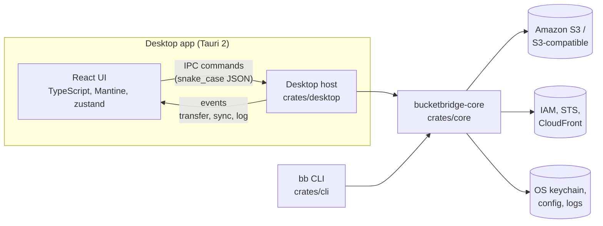

<p align="center">
  <picture>
    <source media="(prefers-color-scheme: dark)" srcset="assets/brand/logo-dark.svg">
    
  </picture>
</p>

<p align="center">
  <b>An open-source S3 client for Windows, macOS and Linux.</b><br>
  A desktop app and a scriptable command-line tool, built on one shared Rust core.
</p>

<p align="center">
  
  
  
  
  
</p>

<p align="center">
  
  
  
  
  
  
  
  
</p>

<p align="center">
  
  
  
  
  
  
</p>

---

BucketBridge works with **Amazon S3** and any **S3-compatible service** (custom
endpoint, path-style addressing). You can browse buckets, move data both ways
through a resumable transfer queue, and keep folders in sync. You can also
manage bucket and object configuration, IAM users and CloudFront
distributions. Everything the desktop app does lives in a Rust library that
the `bb` CLI uses too, so the app and your scripts behave the same way.

There is no account, activation or licence key, and no telemetry: the app
never contacts a server on its own. Secrets stay in the operating system's
credential store.

<p align="center">
  <picture>
    <source media="(prefers-color-scheme: dark)" srcset="assets/screenshots/main-dark.png">
    
  </picture>
</p>

<table>
  <tr>
    <td align="center"><br><sub>Object properties</sub></td>
    <td align="center"><br><sub>Folder sync analysis</sub></td>
    <td align="center"><br><sub>Context menus</sub></td>
  </tr>
</table>

## Contents

- [Install](#install)
- [Highlights](#highlights)
- [Features](#features)
- [Architecture](#architecture)
- [Repository layout](#repository-layout)
- [How the pieces work](#how-the-pieces-work)
- [Security model](#security-model)
- [Getting started](#getting-started)
- [Using the CLI](#using-the-cli)
- [Configuration](#configuration)
- [Testing](#testing)
- [Quality checks](#quality-checks)
- [Releases and packaging](#releases-and-packaging)
- [Known limitations](#known-limitations)
- [Roadmap](#roadmap)
- [Documentation](#documentation)
- [Contributing](#contributing)
- [License](#license)
- [Author](#author)

## Install

Download the latest version from the
[Releases page](https://github.com/anupshaw50/BucketBridge/releases/latest).

| Platform | Desktop app | Command line (`bb`) |
|---|---|---|
| **Windows** 10 and 11 (x64) | `BucketBridge_<version>_windows_x64.msi` installer, or the portable `.zip` (no install, run `BucketBridge.exe`) | `bb_<version>_windows_x64.zip` |
| **macOS** 11+ (Apple silicon and Intel) | `BucketBridge_<version>_macos_universal.dmg` | `bb_<version>_macos_universal.tar.gz` |
| **Linux** (x86_64) | `.AppImage` (any distribution), `.deb` (Debian, Ubuntu), or `.tar.gz` | `bb_<version>_linux_x86_64.tar.gz` |

Package managers (winget, Scoop, Homebrew) are planned but not available yet.
Manifests are ready in [`packaging/`](packaging).

Check a download against `SHA256SUMS` from the release:
`Get-FileHash <file>` (Windows), `shasum -a 256 <file>` (macOS),
`sha256sum <file>` (Linux).

> Builds are not code-signed yet. On Windows, SmartScreen may ask you to
> confirm ("More info", then "Run anyway"). On macOS, open the app the first
> time with right-click, then Open.

## Highlights

| | |
|---|---|
| **One core, two front ends** | `bucketbridge-core` holds all the S3, transfer, sync, crypto and configuration logic. The Tauri desktop app and the `bb` CLI are thin layers over it. |
| **Transfers you can trust** | Multipart uploads with checksums, pause, resume and retry, one shared bandwidth cap, and resume after a restart. A cancelled transfer never leaves a partial object or file behind. |
| **Safe by default** | Keys live in the OS keychain, with an optional master password (Argon2id + AES-256-GCM). Objects can be encrypted on your machine before upload, destructive actions need typed confirmation, and the app runs under a strict Content Security Policy. |
| **Works beyond AWS** | Custom endpoints, path-style addressing, requester pays and per-bucket region routing. Menus hide what an S3-compatible server does not support. |
| **Scriptable** | `bb` prints one NDJSON record per item with `--json`, supports `--dry-run`, and has stable exit codes. |
| **Heavily tested** | More than 1,700 Rust tests and more than 480 UI tests, plus Playwright smoke tests. The Rust tests cover unit logic, an in-process S3 server, scripted mock servers, and the desktop commands called through Tauri's mock runtime. |

## Features

<details open>
<summary><b>Accounts and security</b></summary>

| Feature | Details |
|---|---|
| Accounts | Several accounts in use at the same time. Each has a label, keys, region, custom endpoint, path-style and requester-pays settings. |
| Secrets | Stored in the OS keychain (macOS Keychain, Windows Credential Manager, Secret Service on Linux). Never written to disk in plaintext. |
| Master password | Optional; encrypts every stored secret. Unlock once per session, and change or remove it later. |
| MFA | Temporary credentials (STS session tokens) from an MFA device code, kept in memory only. |
| Proxies | HTTP and SOCKS5, with authentication and a bypass list (host names, `*.suffix`, IPs, CIDR ranges). |

</details>

<details open>
<summary><b>Browsing and objects</b></summary>

| Feature | Details |
|---|---|
| Browsing | Bucket tree, folders, flat browsing, search, paging, bookmarks, several windows. |
| Object operations | Upload and download files and folders. Copy, move, rename, delete, create folders, open, and open with another app. Copy or move files and whole folders to a chosen folder, and paste into a bucket. |
| Metadata | HTTP headers, user metadata, tags, storage class, server-side encryption (SSE-S3, SSE-KMS, SSE-C), canned ACLs and website redirect. Batch editing, with a result per object. |
| Versions | Version list with filters and delete markers. Restore or permanently delete a version, or download an old one. |
| Preview | Images, text and JSON, with paging through large files. |
| Sharing | Presigned GET and PUT links, and a sharing wizard. Optional URL shortening through Bitly or TinyURL (off by default). |
| Object lock and archive | Retention, legal hold, bucket default, governance bypass, object ownership, MFA delete, and Glacier restore with tier and days. |
| Client-side encryption | Optional gzip or zstd compression plus AES-256-GCM before upload, and decryption on download. |

</details>

<details open>
<summary><b>Transfers and sync</b></summary>

| Feature | Details |
|---|---|
| Transfer queue | Configurable concurrency, pause, resume, cancel and retry, start or stop all, and views by state. The queue survives an app restart. |
| Multipart | Multipart upload starts at 8 MiB, with 8 MiB parts by default. Parts grow so no upload needs more than 10,000, and up to 4 parts are in flight per task. Objects over 5 GiB are copied on the server with `UploadPartCopy`. |
| Bandwidth | One cap shared by all transfers. |
| Integrity | CRC32 request checksums by default (CRC32C, CRC64NVME, SHA-1 and SHA-256 available). Downloads are validated, and `Content-MD5` is sent where S3 requires it. |
| Folder sync | Upload, download or both ways. A dry run shows one row per file (copy, delete, equal, failed) before anything changes. Execution is journaled and resumable, and reports failures per row instead of stopping. |

</details>

<details open>
<summary><b>Buckets, services and tools</b></summary>

| Feature | Details |
|---|---|
| Bucket configuration | Create and delete buckets, edit the policy with validation, public access block, versioning, access logging, static website and routing rules, transfer acceleration, and pinned external buckets. |
| Bucket rules | CORS, lifecycle, Intelligent-Tiering and replication rules, edited as JSON and validated before sending. |
| IAM | Users, console passwords, access keys (the secret is shown once), and managed and inline policies. |
| CloudFront | Distributions per bucket: create, edit, enable or disable, and detach. Invalidations with wildcards, and their history. |
| Security scan | Per bucket, flags public ACLs and policies, a missing public access block, missing encryption, versioning off and ACLs enabled. Results can be exported. |
| Diagnostics | A step-by-step connection probe, timing each step: DNS, TCP, proxy tunnel, TLS with the certificate, a signed request, and the bucket region. |
| Maintenance | List and abort unfinished multipart uploads, saved filters, and export of listings to CSV, Excel or Parquet. |
| Mount as drive | Optional build: a read-only view of a bucket through FUSE (Linux, macOS) or Dokan (Windows). |
| App shell | Settings, context menus, keyboard shortcuts, event log with filter and export, local crash reports, single instance, light and dark theme. |

</details>

## Architecture



- **Core (`crates/core`)**: the whole domain. It contains:
  - AWS SDK clients per account, with per-bucket region routing.
  - The transfer engines and queue, and sync.
  - Object metadata and bucket configuration.
  - IAM and CloudFront.
  - Encryption, configuration and logging.

  It knows nothing about Tauri or the terminal.
- **Desktop host (`crates/desktop`)**: owns one `Core` (session, transfer
  queue, sync store, event log) and exposes it to the UI as about 170 Tauri
  commands and 7 event channels. The contract with the UI is
  [`docs/desktop-api.md`](docs/desktop-api.md); it is updated first whenever
  a shape changes.
- **UI (`ui/`)**: React 19 with Mantine and zustand. `ui/src/api` mirrors the
  contract in TypeScript, and `ui/src/mock` implements the same contract in
  the browser. That lets the UI run and be tested without Rust or S3.
- **CLI (`crates/cli`)**: `bb`, built with clap. It is a library plus a thin
  binary, so tests run commands in-process.

Dependencies point one way: `cli`, `desktop` and `tests` depend on `core`, and
`core` depends on no other workspace crate. TLS is rustls everywhere; OpenSSL
is not used. `unsafe` code is forbidden in every crate.

## Repository layout

```
BucketBridge/
├── crates/
│   ├── core/          bucketbridge-core: the domain library (about 72k lines)
│   │   └── src/       accounts, secrets, session, mfa, proxy, client, ops,
│   │                  engine/ (upload, download, copy, move, delete),
│   │                  transfer/ (queue, bandwidth, persistence), sync/,
│   │                  bucketcfg, bucketrules, objectmeta/, objectlock/,
│   │                  versions, preview, cse/, iam, cloudfront/, scan,
│   │                  diagnostics, export, filter, bookmarks, mount/, ...
│   ├── cli/           bucketbridge-cli: the `bb` binary and its tests
│   └── desktop/       bucketbridge-desktop: the Tauri host, icons, capabilities,
│                      IPC tests on Tauri's mock runtime
├── tests/             bucketbridge-tests: integration harness and suites
│                      (in-process S3 server, scripted mock S3, raw server,
│                      MinIO behind a feature)
├── ui/                React + TypeScript app (Vite), fake backend, Playwright
├── assets/brand/      logo, mark and application icon (SVG)
├── docs/              design and reference documentation
├── scripts/ci/        release helpers (archives, checksums, licence check)
├── .github/workflows/ release.yml (tag-triggered release build)
├── deny.toml          cargo-deny policy (advisories, licences, sources)
└── about.toml         cargo-about policy for the third-party notice
```

Rough size, in lines of Rust and TypeScript:

| Part | Lines |
|---|---|
| Core | 72k |
| UI | 43k |
| Integration tests | 23k |
| CLI | 19k |
| Desktop host | 13k |

## How the pieces work

**A request.**
- Every account gets its own S3 client.
- `S3::client_for(bucket)` resolves the bucket's region once and caches a regional client, so buckets in different regions just work.
- Metadata calls get a 60 s read timeout per request. Uploads and long server-side copies have no read timeout; stalled-stream protection catches a stuck transfer instead, so a slow upload is never cut off.
- Retries use the SDK's standard mode: 5 attempts by default, with exponential backoff and jitter.

**A transfer.**
- The UI or CLI adds a task to the `TransferQueue`.
- The queue runs tasks within the concurrency limit and the shared bandwidth cap.
- Each task runs through an engine (`engine/`), which emits progress events and retries transient failures.
- The queue saves itself to disk, so work resumes after an app restart.
- A failed multipart upload keeps its finished parts for the retry. Cancelling aborts it, so nothing is left on the server.
- Downloads are written under a temporary name and removed if cancelled.

**A sync.**
1. The scanner lists both sides.
2. The planner produces a `SyncPlan` with one row per path.
3. The user reviews the plan (dry run).
4. Execution is journaled in the `SyncStore`. An interrupted run continues where it stopped, and a failing row is reported without aborting the rest.

**Errors.**
- Every failure is an `Error` with one kind: `usage`, `auth`, `locked`, `mfa_required`, `not_found`, `conflict`, `remote`, `io`, `internal` or `cancelled`.
- The desktop app sends it to the UI as `{ code, message }`; the CLI maps the kind to an exit code.
- Service errors keep the S3 error code, HTTP status and request ID.
- Messages add hints where they help, for example to fix the computer's clock on `RequestTimeTooSkewed`.

**Menus.**
- Context menus, the toolbar and keyboard shortcuts all use the same action registry (`ui/src/features/menus`).
- Entries a server cannot support are hidden.
- Entries that don't apply to the current selection are shown disabled.

## Security model

| Topic | What BucketBridge does |
|---|---|
| Stored secrets | Secret keys, session tokens, proxy passwords and shortener tokens live in the OS keychain. `config.toml` (mode 0600, atomic writes) holds only references. |
| Master password | Optional. Each secret becomes an envelope (`0xBB, 0x01, nonce, AES-256-GCM ciphertext, tag`) under a key derived with Argon2id (256 MiB, 3 passes). A wrong password is rejected without data loss. |
| Client-side encryption | Chunked AES-256-GCM with a per-object Argon2id key, and optional gzip or zstd. The header and the chunk order are authenticated, so reordering, truncating or editing the data makes decryption fail. A key check distinguishes a wrong password from damaged data. |
| Desktop shell | Strict Content Security Policy, narrowly scoped Tauri permissions, single instance, and downloads checked against path traversal. |
| Network | rustls only. Proxies and the bypass list apply to every SDK client. |
| Privacy | No telemetry and no update phone-home: checking for updates opens the releases page in your browser. Crash reports are written locally and never uploaded. |
| Supply chain | Every Rust dependency passes `cargo deny` (advisories, permissive licences only, crates.io only) and `cargo about`. npm production dependencies have their own licence check. |

Details: [`docs/security.md`](docs/security.md).

## Getting started

### Prerequisites

- Rust stable (edition 2024) via rustup. Some shells need `~/.cargo/bin` added to `PATH`.
- Node.js and pnpm (the pnpm version is pinned in `package.json`).
- On Linux only, the Tauri system packages (WebKitGTK and related libraries).

Per-OS details: [`docs/development.md`](docs/development.md).

### Build and run

```bash
pnpm install

# Desktop app with hot reload (Vite needs port 5173 to be free)
pnpm tauri dev

# Desktop app bundle, no dev server needed
pnpm tauri build --debug --bundles app      # macOS: target/debug/bundle/macos/BucketBridge.app

# The UI alone in a browser, with the built-in fake backend (no S3 needed)
pnpm --dir ui dev

# The CLI
cargo build -p bucketbridge-cli
./target/debug/bb --help
```

> A plain `cargo build` of the desktop crate produces a development binary that
> loads the UI from `localhost:5173`. Ship only `pnpm tauri build` output.

### Try it without touching your real settings

```bash
BB_CONFIG_DIR=/tmp/bb-try pnpm tauri dev
BB_CONFIG_DIR=/tmp/bb-try ./target/debug/bb account list
```

### Optional: mount a bucket as a drive

```bash
cargo build -p bucketbridge-cli --features mount
./target/debug/bb mount my-bucket /mnt/my-bucket     # Windows: bb mount my-bucket X:
```

This needs libfuse (Linux), macFUSE (macOS) or the Dokan 2 runtime (Windows).
See [`docs/mount.md`](docs/mount.md).

## Using the CLI

```bash
# Store an account; the secret key is read from stdin, BB_SECRET_ACCESS_KEY or a prompt
bb account add --label work --access-key-id AKIA...

bb ls s3://my-bucket/photos/ --long
bb cp ./site s3://my-bucket/www/ --recursive --exclude '*.tmp'
bb cp s3://my-bucket/report.csv . --json          # one NDJSON record per item
bb sync ./backup s3://my-bucket/backup --delete --dry-run
bb presign s3://my-bucket/file.zip --expires 1h
bb cp secret.pdf s3://my-bucket/ --encrypt --compress zstd --password-file ./pw
bb lock get s3://my-bucket/contracts/
bb scan --bucket my-bucket --json > scan.ndjson
bb export s3://my-bucket/ --format parquet --out listing.parquet
```

| Group | Commands |
|---|---|
| Accounts | `account add`, `account list`, `account remove`, `account default` |
| Buckets and objects | `ls`, `mb`, `rb`, `rm`, `cp`, `mv`, `sync`, `presign`, `restore-version` |
| Metadata | `tag`, `storage-class`, `sse`, `acl`, `lock`, `restore` |
| Encryption | `encrypt`, `decrypt`, and `--encrypt` / `--decrypt` on `cp` and `mv` |
| Services | `iam`, `cloudfront` |
| Tools | `mpu list`, `mpu abort`, `scan`, `export`, `mount` (optional build) |

Without a stored account, `bb` uses `BB_ACCESS_KEY_ID`, `BB_SECRET_ACCESS_KEY`,
`BB_SESSION_TOKEN`, `BB_REGION`, `BB_ENDPOINT` and `BB_PATH_STYLE`.

| Exit code | Meaning |
|---|---|
| 0 | success |
| 1 | usage error |
| 2 | remote, not found, conflict or local I/O error |
| 3 | authentication, locked secrets or MFA required |
| 130 | cancelled |

Full reference: [`docs/cli.md`](docs/cli.md).

## Configuration

| | Linux | macOS | Windows |
|---|---|---|---|
| `config.toml` | `~/.config/bucketbridge` | `~/Library/Application Support/BucketBridge` | `%APPDATA%\BucketBridge\config` |
| Data (queue, sync plans) | `~/.local/share/bucketbridge` | `~/Library/Application Support/BucketBridge` | `%LOCALAPPDATA%\BucketBridge\data` |
| Logs and crash reports | `~/.local/state/bucketbridge` | `~/Library/Application Support/BucketBridge` | `%LOCALAPPDATA%\BucketBridge\data` |

| Variable | Purpose |
|---|---|
| `BB_CONFIG_DIR` | Put configuration, data, logs and crash reports in one folder (portable use, tests). |
| `BB_MASTER_PASSWORD` | Unlock stored secrets in the CLI without a prompt. |
| `BB_CSE_PASSWORD` | Password for client-side encryption in the CLI. |
| `BB_SHORTENER_TOKEN`, `BB_SHORTENER_ENDPOINT` | URL shortener token and endpoint override for `bb presign --shorten`. |
| `BB_ACCESS_KEY_ID`, `BB_SECRET_ACCESS_KEY`, `BB_SESSION_TOKEN`, `BB_REGION`, `BB_ENDPOINT`, `BB_PATH_STYLE` | An account from the environment, without storing it. |

Settings are edited in the app and validated by the core. They cover general,
interface, advanced, data integrity, logging, proxy and sharing options.

## Testing

```bash
cargo test --workspace                              # all Rust tests, no Docker needed
cargo test -p bucketbridge-tests --test queue_s3    # one integration suite
pnpm --dir ui test                                  # UI unit and component tests (Vitest)
pnpm --dir ui e2e                                   # Playwright smoke tests on the fake backend
BB_TEST_BACKEND=minio cargo test -p bucketbridge-tests --features minio   # needs Docker
```

| Layer | How |
|---|---|
| Core unit tests | Pure logic: sync planner, filters, path normaliser, crypto formats, part sizing. |
| Integration (`tests/`) | Four backends: <br>- `TestS3`, an in-process S3 server (s3s-fs). <br>- `MockS3`, a scripted server that records requests, for header-level assertions. <br>- A raw server, for timeouts and broken responses. <br>- MinIO, for what s3s-fs lacks (versioning, tagging, multipart listing). |
| Other AWS services | IAM, STS and CloudFront through `aws-smithy-mocks`. |
| Desktop | Commands invoked through Tauri's IPC path on the mock runtime, exactly as the UI sends them. |
| CLI | Commands run in-process, checking captured output, exit codes and NDJSON records. |
| UI | Vitest and Testing Library against the fake backend; Playwright for end-to-end smoke tests. |

Tests never touch the real keychain. Harness details: [`docs/testing.md`](docs/testing.md).

## Quality checks

There is no CI on push, so run these before committing:

```bash
cargo fmt --all --check
cargo clippy --workspace --all-targets -- -D warnings
cargo test --workspace
pnpm --dir ui typecheck && pnpm --dir ui lint && pnpm --dir ui test && pnpm --dir ui build
cargo deny check && cargo about generate about.hbs
```

## Releases and packaging

Pushing a `v*` tag runs [`release.yml`](.github/workflows/release.yml), which
builds these artefacts and attaches them to a draft GitHub release:

| Platform | Artefacts |
|---|---|
| Windows | `.msi` installer, portable `.zip`, `bb` archive |
| macOS | universal `.dmg` (Apple silicon and Intel), `bb` archive |
| Linux | `.AppImage`, `.deb`, `.tar.gz`, `bb` archive |

Every artefact ships with `LICENSE` and `THIRD_PARTY_LICENSES.html`, and the
release includes `SHA256SUMS`. Code signing and notarisation switch on when
their secrets are configured. Details: [`docs/packaging.md`](docs/packaging.md).

## Known limitations

- Mounting is read-only and ships only in builds with `--features mount`. The
  Windows (Dokan) adapter has not yet been run on a Windows machine.
- Copy to and move to work within one account.
- `bb sync` does not encrypt. Client-side encryption is available on `cp`,
  `mv`, `encrypt` and `decrypt`.
- `bb presign --shorten` cannot read a stored shortener token while a master
  password is set; use `BB_SHORTENER_TOKEN` instead.
- Window size and position are not remembered between runs.

## Roadmap

Planned work is in [`ROADMAP.md`](ROADMAP.md), grouped by priority with rough
sizes. The first priority is access and data movement: AWS IAM Identity Center
(SSO), assume role, AWS shared configuration profiles, cross-account copy and
move, saved sync jobs, and an overwrite policy for existing files. Suggestions
are welcome as issues.

## Documentation

| Document | Contents |
|---|---|
| [`docs/architecture.md`](docs/architecture.md) | Workspace, core module map, error model, directories, retries, checksums, multipart |
| [`docs/development.md`](docs/development.md) | Prerequisites, building, testing, linting, licence audit |
| [`docs/desktop-api.md`](docs/desktop-api.md) | The IPC contract between the desktop host and the UI |
| [`docs/desktop.md`](docs/desktop.md) | Desktop host: state, commands, events, CSP, capabilities, bundles |
| [`docs/ui.md`](docs/ui.md) | UI structure, fake backend, context menus, keyboard, tests |
| [`docs/cli.md`](docs/cli.md) | Every `bb` command, its records and exit codes |
| [`docs/engines.md`](docs/engines.md) | Upload, download, copy, move and delete engines |
| [`docs/transfers.md`](docs/transfers.md) | Transfer queue: states, scheduling, retries, persistence, bandwidth |
| [`docs/sync.md`](docs/sync.md) | Sync rules, planner and execution |
| [`docs/security.md`](docs/security.md) | Secrets, master password, MFA, proxies, client-side encryption |
| [`docs/logging.md`](docs/logging.md) | Event log and crash reports |
| [`docs/mount.md`](docs/mount.md) | The optional read-only mount |
| [`docs/testing.md`](docs/testing.md) | Test harness and backends |
| [`docs/packaging.md`](docs/packaging.md) | Releases, signing, licence audit |
| [`CHANGELOG.md`](CHANGELOG.md) | What changed in each version |
| [`ROADMAP.md`](ROADMAP.md) | Planned features by priority |
| [`assets/brand/README.md`](assets/brand/README.md) | Logo files, colours and how to regenerate the icons |

## Contributing

Contributions are welcome. Start with [`CONTRIBUTING.md`](.github/CONTRIBUTING.md);
report bugs and request features through the
[issue forms](https://github.com/anupshaw50/BucketBridge/issues/new/choose), and
report security problems privately as described in
[`SECURITY.md`](.github/SECURITY.md). Everyone taking part follows the
[code of conduct](.github/CODE_OF_CONDUCT.md). Good first tasks are in the
[roadmap](ROADMAP.md).

- Run the [quality checks](#quality-checks) before a commit.
- When a desktop command or event changes, update
  [`docs/desktop-api.md`](docs/desktop-api.md) first, then `ui/src/api` and the
  fake backend in `ui/src/mock`.
- Every `aws-sdk-*` dependency uses `default-features = false` with
  `default-https-client` and `rt-tokio`.
- Use only permissively licensed (GPL-3.0 compatible) dependencies; `cargo deny check` must pass.
- Do not use the em dash character in code, docs or UI text.

## License

BucketBridge is free software, licensed under the
[GNU General Public License, version 3](LICENSE) (`GPL-3.0-only`). You may use,
study, share and change it; anyone who distributes it, or a modified version,
must make the complete source code available under the same licence.

Its dependencies are all under permissive licences (MIT, Apache-2.0, BSD and
similar) or MPL-2.0, which are compatible with GPL-3.0; their notices ship in
`THIRD_PARTY_LICENSES.html` with every release.

## Author

BucketBridge is created and maintained by **Anup Shaw**
([@anupshaw50](https://github.com/anupshaw50)).
If it is useful to you, a star on GitHub helps others find it, and
[sponsoring](https://github.com/sponsors/anupshaw50) supports further work.

Copyright (C) 2026 Anup Shaw (anupshaw50).
